# 🛍️ ShopVibe — Plataforma de Dados em Tempo Real (MVP)

Repositório oficial do MVP de Engenharia de Dados e Arquitetura de Streaming desenvolvido para a **ShopVibe**. Este projeto resolve os gargalos de processamento em lote (*batch* de 24h) da loja, capturando eventos transacionais via **Change Data Capture (CDC)** em sub-segundos para alimentar um painel de vendas ao vivo, armazenamento bruto para auditoria (Camada Bronze) e um motor de detecção de fraudes em tempo real (Camada Gold).

**Autores do Grupo:**
- Cauê Felipe Mascarenhas
- Otavio Gomes da Silva
  
---

## 🎯 1. O Problema de Negócio e Requisitos Atendidos

No modelo anterior (*As-Is*), o e-commerce copiava dados do PostgreSQL apenas às 2h da manhã, gerando cancelamentos por ruptura de estoque, prejuízos de R$ 180 mil em *chargebacks* por fraudes descobertas tarde demais e perda de carrinhos abandonados.

### Matriz de Rastreabilidade de Requisitos

| Código | Requisito | Como a Arquitetura Resolve |
|---|---|---|
| **RF01** | Capturar cada novo pedido em poucos segundos | **Debezium + Kafka Connect** lendo o log binário (`WAL`) do PostgreSQL e publicando no **Apache Kafka**. |
| **RF02** | Armazenar eventos brutos para reprocessamento (Camada Raw / Bronze) | Consumidor Python realiza *upsert* do envelope JSON completo do CDC na coleção `raw_orders` do **MongoDB**. |
| **RF03** | Manter contador de vendas do dia (R$ e Qtd) em tempo real (Camada Gold) | Contadores atômicos em memória no **Redis** (`INCR` e `INCRBYFLOAT`) com garantia de idempotência via `SADD`. |
| **RF04** | Expor os dados por uma API REST | **FastAPI** expondo `/vendas/hoje`, `/pedidos/{id}` e `/alertas/fraude` com documentação Swagger automática. |
| **RF05** *(Diferencial)* | Alerta quando um mesmo cliente fizer >5 pedidos em 2 minutos | Janela deslizante no **Redis** por `customer_id` usando `INCR` + `EXPIRE 120` e fila de alertas em tempo real. |
| **RNF01 a RNF05** | Latência <2s, Escalabilidade (20x Black Friday), Durabilidade, `docker compose up` e Open Source | Kafka KRaft com retenção em disco, Consumer Groups escaláveis horizontalmente e container `debezium-init` automatizado. |

---

## 🏗️ 2. Desenho da Solução (Diagrama de Arquitetura)

> *O GitHub renderiza o diagrama Mermaid abaixo automaticamente.*

```mermaid
flowchart TB
    %% Definição de Estilos por Camada
    classDef source fill:#e3f2fd,stroke:#1565c0,stroke-width:2px,color:#0d47a1
    classDef ingest fill:#fff3e0,stroke:#ef6c00,stroke-width:2px,color:#e65100
    classDef stream fill:#fce4ec,stroke:#c2185b,stroke-width:2px,color:#880e4f
    classDef process fill:#f3e5f5,stroke:#7b1fa2,stroke-width:2px,color:#4a148c
    classDef bronze fill:#efebe9,stroke:#5d4037,stroke-width:2px,color:#3e2723
    classDef gold fill:#fff8e1,stroke:#f9a825,stroke-width:2px,color:#f57f17
    classDef serving fill:#e8f5e9,stroke:#2e7d32,stroke-width:2px,color:#1b5e20
    classDef client fill:#eceff1,stroke:#455a64,stroke-width:2px,stroke-dasharray: 5 5,color:#263238

    %% 1. CAMADA DE ORIGEM
    subgraph C1 ["1. Origem (Transacional)"]
        direction LR
        APP("📱 App / Site ShopVibe"):::client
        PG[("🐘 PostgreSQL 16\n(wal_level = logical)\nTabelas: orders, order_items")]:::source
        APP -->|"1. Grava pedido (INSERT)"| PG
    end

    %% 2. CAMADA DE INGESTÃO
    subgraph C2 ["2. Ingestão em Tempo Real (ADR-002)"]
        direction LR
        DEB{{"⚡ Kafka Connect + Debezium CDC"}}:::ingest
    end

    %% 3. CAMADA DE TRANSPORTE / STREAMING
    subgraph C3 ["3. Transporte / Streaming (ADR-001)"]
        direction LR
        KAFKA[["📨 Apache Kafka (Modo KRaft)\nTópico: shopvibe.public.orders | Retenção: 7 dias"]]:::stream
    end

    %% 4. CAMADA DE PROCESSAMENTO
    subgraph C4 ["4. Processamento (Stream Worker)"]
        direction LR
        WORKER["🐍 Consumidor Python (Consumer Group: shopvibe-realtime-cg)\n• Parsing do payload CDC\n• Agregação de Vendas e Regra de Fraude (>5 ped/2min)"]:::process
    end

    %% 5. CAMADA DE ARMAZENAMENTO (PERSISTÊNCIA POLIGLOTA)
    subgraph C5 ["5. Armazenamento Poliglota (ADR-003)"]
        direction LR
        MONGO[("🍃 MongoDB [Camada Raw / Bronze]\nPayload CDC Bruto JSON\n(RF02 - Reprocessamento)")]:::bronze
        REDIS[("⚡ Redis In-Memory [Camada Refined / Gold]\n• Contadores R$ e Qtd (RF03)\n• Janela Fraude TTL 120s (RF05)")]:::gold
    end

    %% 6. CAMADA DE ENTREGA
    subgraph C6 ["6. Entrega / Consumo (ADR-004)"]
        direction TB
        API["🚀 FastAPI (REST + Swagger)\n• GET /vendas/hoje  |  • GET /pedidos/{id}  |  • GET /alertas/fraude"]:::serving
        DASH("👩‍💼 Diretoria (Painel ao Vivo) & Time Antifraude"):::client
    end

    %% Fluxo Vertical de Dados (Cima para Baixo)
    PG -->|"2. Lê log binário (WAL) [CDC sub-segundo]"| DEB
    DEB -->|"3. Publica evento JSON (RF01 / RNF03)"| KAFKA
    KAFKA -->|"4. Consome em paralelo (RNF02 - Escala Horizontal)"| WORKER
    
    WORKER -->|"5a. Grava evento bruto\n(Upsert por order_id)"| MONGO
    WORKER -->|"5b. Incrementa contadores\n(INCR / INCRBYFLOAT / EXPIRE)"| REDIS

    MONGO -.->|"6a. Consulta pedido por ID\n(GET /pedidos/{id})"| API
    REDIS -.->|"6b. Lê métricas e alertas O(1)\n(Latência < 5ms)"| API
    API -->|"7. Exibe em Tempo Real (RF04 / RNF01)"| DASH
```



---

## 📂 3. Estrutura do Repositório

```text
shopvibe-mvp/
├── docker-compose.yml       # Sobe toda a infraestrutura e registra o Debezium automaticamente
├── init.sql                 # Cria tabelas orders e order_items com REPLICA IDENTITY FULL
├── README.md                # Documentação geral, Diagrama e ADRs
└── app/
    ├── Dockerfile           # Imagem Python 3.11 para o Consumer e para a API
    ├── requirements.txt     # Dependências (confluent-kafka, pymongo, redis, fastapi, psycopg2)
    ├── consumer.py          # Worker Kafka -> MongoDB (Bronze) + Redis (Gold & Antifraude)
    ├── api.py               # Endpoints REST FastAPI (/vendas/hoje, /pedidos/{id}, /alertas/fraude)
    └── simulator.py         # Gerador de carga (vendas normais e ataque de fraude na Black Friday)
```

---

## 🚀 4. Como Executar e Demonstrar o Projeto

### Pré-requisitos
* **Docker** e **Docker Compose** instalados.

### Passo 1: Subir o ambiente completo (RNF04)
Clone o repositório e execute um único comando na raiz do projeto:

```bash
git clone https://github.com/otaviohub/shopvibe-mvp.git
cd shopvibe-mvp
docker compose up --build -d
```
> **Nota:** O serviço `shopvibe-debezium-init` aguarda o Kafka Connect iniciar e registra o conector `shopvibe-orders-connector` automaticamente. Caso o consumidor suba alguns segundos antes de o tópico ser criado, basta rodar `docker restart shopvibe-consumer` após ~30 segundos.

### Passo 2: Acompanhar os eventos em tempo real no terminal
Deixe um terminal aberto monitorando os logs do consumidor Python:

```bash
docker logs -f shopvibe-consumer
```

### Passo 3: Simular compras normais e ataques de fraude
Abra um **segundo terminal** e execute o simulador:

1. **Simular 5 compras normais de clientes variados:**
   ```bash
   docker exec -it shopvibe-api python simulator.py normal
   ```
2. **Simular ataque de fraude (7 compras do mesmo cliente em < 3 segundos — RF05):**
   ```bash
   docker exec -it shopvibe-api python simulator.py fraude
   ```

### Passo 4: Consultar a API em Tempo Real (RF04)
Acesse o Swagger interativo no navegador:
* 👉 **`http://localhost:8000/docs`**

Ou consulte diretamente as rotas:
* **Painel do Dia (Camada Gold - Redis):** `http://localhost:8000/vendas/hoje`
* **Evento Bruto por ID (Camada Bronze - MongoDB):** `http://localhost:8000/pedidos/1`
* **Alertas de Fraude (RF05 - Redis):** `http://localhost:8000/alertas/fraude`

---

## 📜 5. Architectural Decision Records (ADRs)

### ADR-001: Usar Apache Kafka (KRaft) como barramento de eventos em tempo real
* **Status:** Aceito
* **Data:** 2026-10-05
* **Autores:** Grupo ShopVibe

#### Contexto
A ShopVibe grava pedidos em PostgreSQL e só processa os dados uma vez por dia, às 2h. Precisamos que cada pedido chegue aos consumidores em menos de 5 segundos (RNF01), sem perda de dados se um componente cair (RNF03), suportando picos de 300 mil pedidos/dia na Black Friday (RNF02).

#### Decisão
Adotar o **Apache Kafka** (em modo **KRaft**, sem necessidade de Zookeeper) como barramento central de eventos.

#### Alternativas consideradas
| Opção | Prós | Contras |
|---|---|---|
| **Apache Kafka (KRaft)** | Retenção em disco permite reprocessamento; múltiplos *Consumer Groups* independentes; integração nativa com Debezium. | Maior consumo de memória RAM que filas simples. |
| **RabbitMQ** | Simples de configurar para filas de tarefas. | Mensagem é removida após consumo; difícil reprocessar histórico. |
| **Polling no PostgreSQL** | Não exige nova infraestrutura. | Sobrecarrega o banco transacional; alto acoplamento; não escala na Black Friday. |

#### Consequências
* **Positivas:** Desacoplamento total entre produtores e consumidores; eventos retidos por 7 dias; escala horizontal via partições.
* **Negativas / riscos:** Exige planejamento de partições e monitoramento de *consumer lag*.

---

### ADR-002: Captura de Eventos em Tempo Real via CDC com Debezium
* **Status:** Aceito
* **Data:** 2026-10-05
* **Autores:** Grupo ShopVibe

#### Contexto
Os pedidos nascem no PostgreSQL. Precisamos capturar cada `INSERT` ou `UPDATE` em poucos segundos (RF01, RNF01) sem perder nenhum pedido (RNF03), sem degradar a performance do banco na Black Friday (RNF02) e sem precisar reescrever o código legado da aplicação da loja.

#### Decisão
Adotar **Change Data Capture (CDC) baseado em log** utilizando o **Debezium Connector for PostgreSQL** sobre o **Kafka Connect**, lendo diretamente o *Write-Ahead Log* (`wal_level = logical`).

#### Alternativas consideradas
| Opção | Prós | Contras |
|---|---|---|
| **Debezium CDC (via WAL)** | Impacto quase zero na CPU do banco; captura sub-segundo; não altera o código da aplicação; garantia de entrega via offsets do LSN. | Exige habilitar replicação lógica no PostgreSQL e manter o container do Kafka Connect. |
| **JDBC Polling (`SELECT` a cada 5s)** | Configuração inicial simples. | Gera *load* constante no banco; perde alterações intermediárias; não escala para 300k pedidos/dia. |
| **Dual Write na Aplicação** | Payload customizado direto na origem. | Risco severo de inconsistência (gravar no Postgres e falhar ao enviar pro Kafka) caso não implemente Transactional Outbox. |

#### Consequências
* **Positivas:** Captura confiável e em tempo real direto do log de transações do PostgreSQL; se o conector cair, retoma exatamente do ponto onde parou.
* **Negativas / riscos:** Se o conector ficar inativo por longo período, o *replication slot* pode reter arquivos WAL em disco no PostgreSQL.
* **O que muda para o time:** O banco passa a operar com `wal_level = logical` e `REPLICA IDENTITY FULL` nas tabelas monitoradas.

---

### ADR-003: Persistência Poliglota com MongoDB (Camada Bronze) e Redis (Camada Gold e Antifraude)
* **Status:** Aceito
* **Data:** 2026-10-05
* **Autores:** Grupo ShopVibe

#### Contexto
O MVP exige três padrões de leitura e escrita muito diferentes:
1. Armazenar o evento bruto completo para auditoria, reprocessamento e busca por `order_id` (RF02, RF04).
2. Atualizar contadores ao vivo de faturamento (R$) e quantidade de pedidos do dia (RF03).
3. Avaliar janelas móveis de 2 minutos por cliente para disparar alertas caso ocorram mais de 5 pedidos (RF05).

#### Decisão
Adotar **Persistência Poliglota**:
1. **MongoDB** para a **Camada Raw/Bronze** (armazenamento documental do JSON bruto do CDC indexado por `_id = order_id`).
2. **Redis** para a **Camada Refined/Gold** (contadores atômicos em memória e controle de janela de fraude com `TTL = 120s`).

#### Alternativas consideradas
| Opção | Prós | Contras |
|---|---|---|
| **MongoDB (Bronze) + Redis (Gold)** | MongoDB aceita o JSON aninhado do Debezium nativamente; Redis executa `INCR`, `INCRBYFLOAT` e `EXPIRE` em sub-milissegundo ($O(1)$). | Dois bancos NoSQL distintos para operar no ambiente. |
| **Apenas Banco Relacional** | Tecnologia única para o time. | Executar `SUM()` e `COUNT()` em tempo real ou gerenciar janelas de 120s via SQL gera contenção sob alta carga. |
| **Apache Cassandra (Bronze)** | Excelente escalabilidade de escrita. | Alto consumo de memória RAM para o MVP local e menor flexibilidade para documentos JSON sem schema fixo. |

#### Consequências
* **Positivas:** Consultas do painel de vendas (`GET /vendas/hoje`) respondem em menos de 2ms sem custo de agregação em disco; expiração automática da janela de fraude de 2 minutos pelo próprio Redis (`EXPIRE`).
* **Negativas / riscos:** O consumidor Python precisa garantir idempotência para não somar duas vezes o mesmo pedido em caso de reprocessamento (resolvido com um conjunto `SADD sales:{data}:processed_orders`).
* **O que muda para o time:** Dados brutos históricos são consultados no MongoDB e indicadores em tempo real no Redis.

---

### ADR-004: Exposição de Dados e Alertas via FastAPI
* **Status:** Aceito
* **Data:** 2026-10-05
* **Autores:** Grupo ShopVibe

#### Contexto
Precisamos expor os indicadores do dia, os pedidos detalhados e os alertas de fraude por meio de uma API REST (RF04) com baixa latência (RNF01), código open source (RNF05) e uma interface visual prática para demonstração ao vivo para a diretoria.

#### Decisão
Utilizar o framework **FastAPI (Python)** com servidor ASGI **Uvicorn** para fornecer os endpoints REST e documentação interativa OpenAPI/Swagger nativa.

#### Alternativas consideradas
| Opção | Prós | Contras |
|---|---|---|
| **FastAPI (Python)** | Altíssima performance; gera interface Swagger UI (`/docs`) automaticamente; mantém todo o projeto na mesma linguagem (Python). | Focado em API (não é uma ferramenta gráfica de BI). |
| **Flask (Python)** | Simples e popular. | Síncrono por padrão (WSGI) e não possui Swagger embutido nativamente. |
| **Node.js (Express)** | Bom desempenho em I/O. | Adicionaria uma segunda linguagem e ecossistema (`npm`/`node_modules`) ao repositório do grupo. |

#### Consequências
* **Positivas:** Padronização da stack em Python 3.11; facilidade de teste imediato pelo navegador via `/docs` durante a apresentação do MVP.
* **Negativas / riscos:** Não inclui camada de autenticação neste MVP inicial, devendo rodar protegido na rede interna.
* **O que muda para o time:** Sistemas consumidores (painel executivo, app de antifraude) passam a consumir contratos JSON padronizados pela FastAPI.
